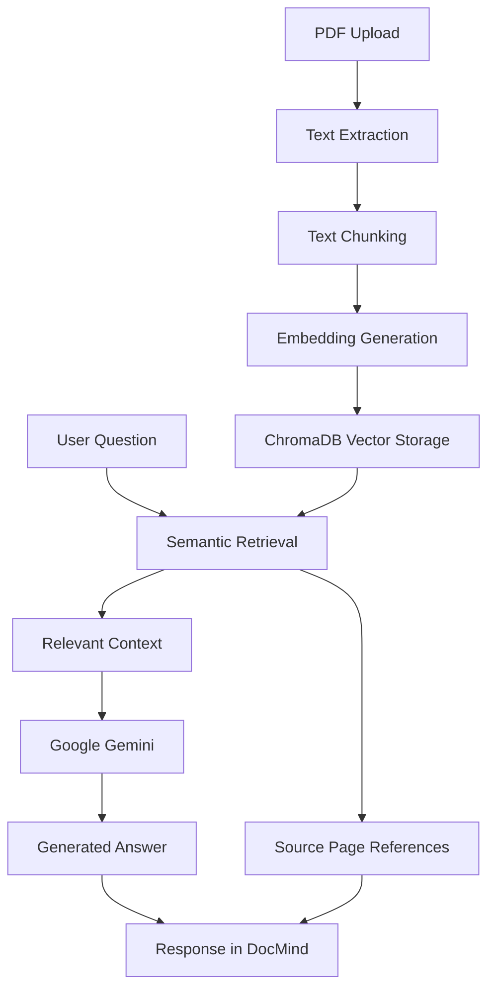

# DocMind


<p align="center">
  <strong>Your documents. Understood.</strong>
</p>

<p align="center">
  An AI-powered document assistant that transforms PDF files into interactive, searchable knowledge using Retrieval-Augmented Generation (RAG).
</p>

<p align="center">
  
  
  
  
</p>

---

## Overview

DocMind is an AI-powered document assistant designed to make information retrieval and document analysis faster and more intuitive.

Users can upload PDF documents, ask questions in natural language, and receive context-aware answers generated from the document's content.

Powered by Retrieval-Augmented Generation (RAG), semantic search, and Google Gemini, DocMind retrieves relevant information before generating responses, helping users understand their documents while maintaining references to the original pages.

## Key Features

| Feature | Description |
|---|---|
| PDF Processing | Extracts text from PDF files while preserving page metadata. |
| Semantic Search | Retrieves relevant document sections based on the meaning of user questions. |
| RAG Architecture | Combines information retrieval with generative AI. |
| AI-Powered Answers | Generates context-aware responses using Google Gemini. |
| Source References | Identifies the document pages associated with retrieved information. |
| Document Isolation | Creates independent vector collections for uploaded documents. |
| Interactive Chat | Allows users to explore document content through natural language. |
| Modern Interface | Provides a streamlined workspace with light and dark themes. |

## How It Works

DocMind follows a Retrieval-Augmented Generation pipeline:



### RAG Pipeline

1. **PDF Upload:** The user uploads a PDF document.
2. **Text Extraction:** PyPDF extracts text from each page while preserving page numbers.
3. **Text Chunking:** LangChain splits the content into smaller, overlapping chunks.
4. **Embedding Generation:** Google Gemini converts document chunks into vector embeddings.
5. **Vector Storage:** ChromaDB stores the embeddings in a dedicated collection.
6. **Semantic Retrieval:** Relevant chunks are retrieved based on the user's question.
7. **Answer Generation:** Google Gemini generates an answer using the retrieved context.
8. **Source References:** DocMind identifies the pages associated with the retrieved information.

## Technology Stack

### Core Language

- **Python** — Main programming language used for application logic, document processing, and RAG implementation.

### Frameworks and Libraries

| Technology | Role |
|---|---|
| Streamlit | Interactive application interface |
| Streamlit PDF Viewer | PDF document preview and rendering |
| LangChain | RAG pipeline orchestration |
| LangChain Google GenAI | Google Gemini integration |
| LangChain Chroma | Vector database integration |
| ChromaDB | Vector storage and semantic retrieval |
| PyPDF | PDF text extraction |
| Python-dotenv | Environment variable management |

### AI Models

| Model | Purpose |
|---|---|
| Gemini 3.5 Flash-Lite | Natural language response generation |
| Gemini Embedding 001 | Document embedding generation |

### Interface Styling

- **CSS** — Custom interface styling and visual refinements within Streamlit.

## Project Structure

```text
docmind/
├── .streamlit/
│   └── config.toml
├── assets/
│   └── screenshots/
├── src/
│   ├── __init__.py
│   ├── pdf_processor.py
│   └── rag_pipeline.py
├── .env.example
├── .gitignore
├── app.py
├── requirements.txt
└── README.md
```

## Getting Started

### Prerequisites

- Python installed on your machine.
- A Google AI API key.

### 1. Clone the repository

```bash
git clone https://github.com/YOUR_GITHUB_USERNAME/docmind.git
cd docmind
```

### 2. Create a virtual environment

```bash
python -m venv .venv
```

Activate it on Windows:

```powershell
.\.venv\Scripts\Activate.ps1
```

### 3. Install dependencies

```bash
pip install -r requirements.txt
```

### 4. Configure environment variables

Create a `.env` file in the project root using `.env.example` as a reference.

```env
GOOGLE_API_KEY=your_google_api_key_here
```

Replace the placeholder with your own Google AI API key.

**Important:** Never commit your `.env` file or expose your API key in a public repository.

### 5. Run the application

```bash
streamlit run app.py
```

The application will be available locally in your browser.

## Project Screenshots

### Document Upload


### AI-Powered Conversation


## Current Limitations

- Supports PDF documents containing extractable text.
- Scanned PDFs without an embedded text layer require OCR, which is not currently implemented.
- Document collections are stored locally using ChromaDB.
- Cloud persistence is not currently implemented.

## Future Improvements

- OCR support for scanned documents.
- Support for additional document formats.
- Advanced retrieval and ranking strategies.
- Persistent cloud-based document storage.
- Expanded document analysis capabilities.

---

<p align="center">
  <strong>DocMind</strong><br>
  Your documents. Understood.
</p>

<p align="center">
  Developed by <a href="https://github.com/LucasGrinsencko1">Lucas Alves Grinsencko</a>
</p>