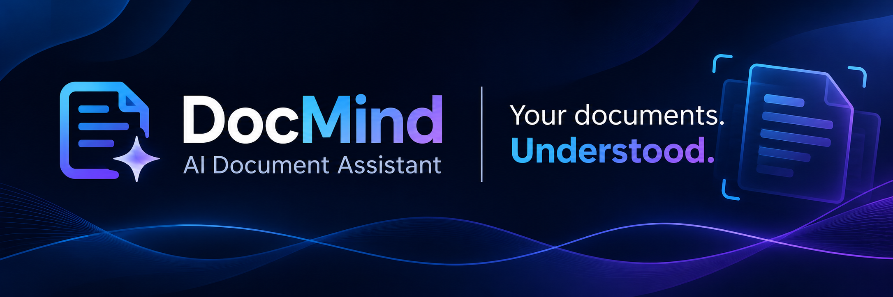
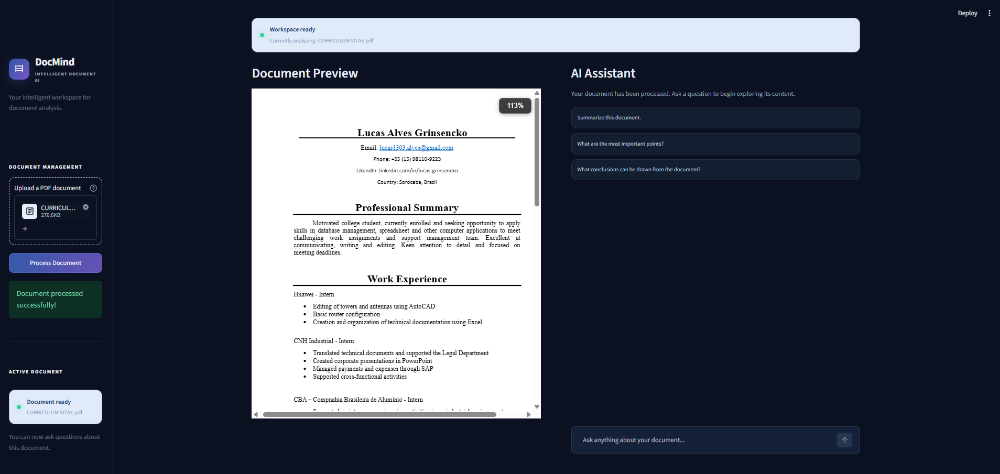
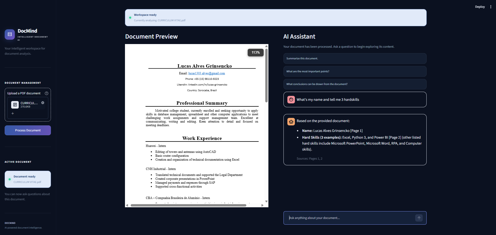

# DocMind



<p align="center">
  <strong>Your documents. Understood.</strong>
</p>

<p align="center">
  An AI-powered document assistant that transforms PDF files into interactive, searchable knowledge using Retrieval-Augmented Generation (RAG).
</p>

<p align="center">
  
  
  
  
</p>

---

## Overview

DocMind is an AI-powered document assistant designed to make information retrieval and document analysis faster and more intuitive.

Users can upload PDF documents, ask questions in natural language, and receive context-aware answers generated from the document's content.

Powered by Retrieval-Augmented Generation (RAG), semantic search, and Google Gemini, DocMind retrieves relevant information before generating responses, helping users understand their documents while maintaining references to the original pages.

## Key Features

| Feature | Description |
|---|---|
| PDF Processing | Extracts text from PDF files while preserving page metadata. |
| Semantic Search | Retrieves relevant document sections based on the meaning of user questions. |
| RAG Architecture | Combines information retrieval with generative AI. |
| AI-Powered Answers | Generates context-aware responses using Google Gemini. |
| Source References | Identifies the document pages associated with retrieved information. |
| Document Isolation | Creates independent vector collections for uploaded documents. |
| Interactive Chat | Allows users to explore document content through natural language. |
| Modern Interface | Provides a streamlined workspace with light and dark themes. |

### RAG Pipeline

1. **PDF Upload:** The user uploads a PDF document.
2. **Text Extraction:** PyPDF extracts text from each page while preserving page numbers.
3. **Text Chunking:** LangChain splits the content into smaller, overlapping chunks.
4. **Embedding Generation:** Google Gemini converts document chunks into vector embeddings.
5. **Vector Storage:** ChromaDB stores the embeddings in a dedicated collection.
6. **Semantic Retrieval:** Relevant chunks are retrieved based on the user's question.
7. **Answer Generation:** Google Gemini generates an answer using the retrieved context.
8. **Source References:** DocMind identifies the pages associated with the retrieved information.

## Technology Stack

### Core Language

- **Python** — Main programming language used for application logic, document processing, and RAG implementation.

### Frameworks and Libraries

| Technology | Role |
|---|---|
| Streamlit | Interactive application interface |
| Streamlit PDF Viewer | PDF document preview and rendering |
| LangChain | RAG pipeline orchestration |
| LangChain Google GenAI | Google Gemini integration |
| LangChain Chroma | Vector database integration |
| ChromaDB | Vector storage and semantic retrieval |
| PyPDF | PDF text extraction |
| Python-dotenv | Environment variable management |

### AI Models

| Model | Purpose |
|---|---|
| Gemini 3.5 Flash-Lite | Natural language response generation |
| Gemini Embedding 001 | Document embedding generation |

### Interface Styling

- **CSS** — Custom interface styling and visual refinements within Streamlit.

## Project Structure

```text
docmind/
├── .streamlit/
│   └── config.toml
├── assets/
│   └── screenshots/
├── src/
│   ├── __init__.py
│   ├── pdf_processor.py
│   └── rag_pipeline.py
├── .env.example
├── .gitignore
├── app.py
├── requirements.txt
└── README.md

```

## 📊 Evaluation & Metrics

To ensure reliability and quality of responses, I evaluated the system across multiple test documents and question types.

### What I Measured
- **Retrieval Relevance:** Whether the chunks found are actually relevant to the user's question
- **Answer Accuracy:** Whether responses are factually correct according to the document
- **Source Attribution:** Whether page references point to the right location
- **Hallucination Rate:** How often the model generates information not present in the document

### Observed Results
- ✅ **Correct responses grounded in the document:** ~90% across technical and informative documents
- ✅ **Accurate page citations:** Consistent in most queries
- ✅ **Rejection of out-of-scope questions:** Correctly responds with "I couldn't find this information in the document" when appropriate
- ⚠️ **Known limitations:** Performance decreases with very short or ambiguous questions; struggles with tables and diagrams
- 🔧 **Future improvements:** Plan to implement automated evaluation using **RAGAS** framework — metrics like context precision, answer relevance, and faithfulness

### Test Examples

| User Question | Expected Behavior | Result |
|---|---|---|
| What is the contract term mentioned on page 3? | Returns the correct duration + page reference | ✅ Correct |
| What is the total amount in section 2? | Extracts the value accurately | ✅ Correct |
| What does the document say about [topic NOT in the file]? | Responds that information wasn't found | ✅ Correct rejection |
| Summarize page 5 in one sentence | Produces accurate, concise summary | ✅ Correct |


## Project Screenshots

### Document Upload



### AI-Powered Conversation



## Current Limitations

- Supports PDF documents containing extractable text.
- Scanned PDFs without an embedded text layer require OCR, which is not currently implemented.
- Document collections are stored locally using ChromaDB.
- Cloud persistence is not currently implemented.

## Future Improvements

- OCR support for scanned documents.
- Support for additional document formats.
- Advanced retrieval and ranking strategies.
- Persistent cloud-based document storage.
- Expanded document analysis capabilities.
- Automated evaluation with RAGAS metrics.

---

<p align="center">
<strong>DocMind</strong><br>
Your documents. Understood.
</p><p align="center">
Developed by <a href="https://github.com/LucasGrinsencko1">Lucas Alves Grinsencko</a>
</p>
